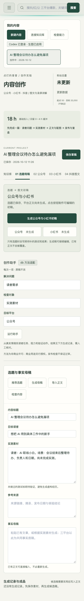
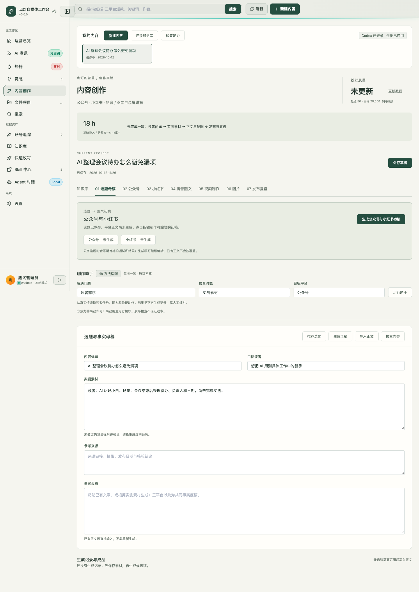
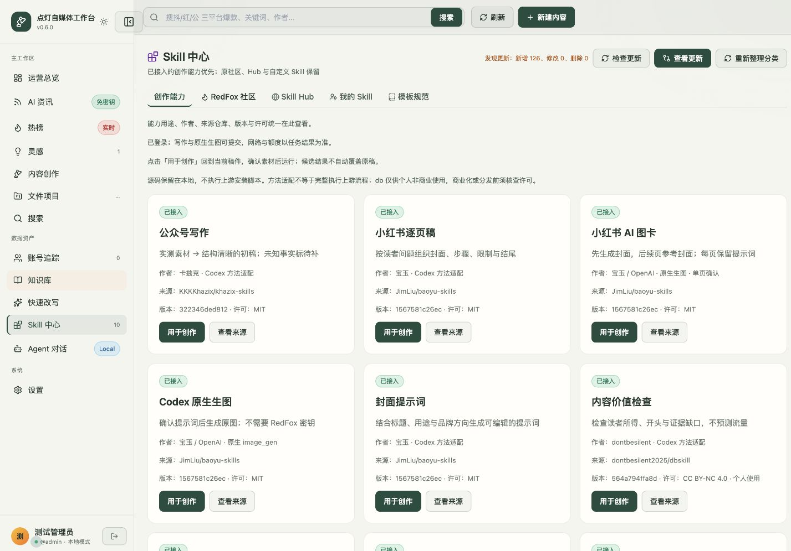

# PRD：点灯自媒体工作台

| 项目 | 内容 |
|------|------|
| 产品 | 点灯自媒体工作台，基于灵感熔炉渐进改造 |
| 文档版本 | 1.2 |
| 状态 | 评审稿；描述目标设计，不代表功能已上线 |
| 更新日期 | 2026-10-12 |
| 关联页面 | 当前系统 `index.html`；本轮未发布的界面改动仅作候选 |
| 业务附件 | [图文研究](图文创作线-调研与打磨方案-2026-10-10.md)、[OB 研究](Obsidian接入与插件调研-2026-10-08.md)、[双平台修复记录](开发任务-双平台创作闭环-2026-10-12.md) |

## 1. 概述

### 1.1 产品任务

帮助「点灯的曾曾」从一个值得讲的 AI 职场问题，完成有本人判断、有事实依据、图文匹配的作品，并拿到各平台可以人工发布的成品包。工作台负责创作过程，Obsidian 保存长期知识，Codex 执行受控的创作任务；用户不需要先学习 Skill 名称或在几个编辑器之间搬运正文。

业务主线为：**信源 → 选题 → 生成稿件 → 图片排版 → 发布成品**。素材核验、审稿、能力调用和保存保护嵌入对应环节，不增加独立的必经流程；复盘与归档是交付后的延伸。

用户为产品背景的自媒体新手，每周可投入 18～22 小时，现有三平台粉丝合计 50。目标读者为 AI 职场小白，女生友好但不限性别。公众号、小红书、抖音都在运营范围；本轮先打磨图文，不把视频完成作为图文上线的前提。

三个月净增 20,000 粉丝是挑战目标，不是产品承诺。首要结果是用户能够独立完成并再次使用工作台创作，而非安装数量、生成次数或页面数量。

### 1.2 本次调整点

1. **统一新创作作品**：新增创作主线以一个作品承接选题、稿件和成品；原 RedFox 工具及快速改写操作保持原样，可按需将结果带入作品，不强制迁移或改写原工具。
2. **交付成品**：明确区分准备稿、待确认初稿、图片制作、发布检查与发布登记；不能把“文字生成成功”当成“图文完成”。
3. **先设计流程**：围绕五步业务主线和当前作品设计页面，再优化视觉。能力中心提供可追溯的方法管理，不承担新手导航。

### 1.3 当前能力与本轮范围

以下“已有”表示源码或相应隔离验证有证据，不等于用户已认可体验，也不表示长期稳定。

| 环节 | 当前证据 | 目标处理 | 优先级 |
|------|----------|----------|--------|
| 选题与信源 | 已有 RedFox 原功能、AIHOT、乔木频道及辅助官方 RSS | 保留三个独立主信源，为选题增加汇集入口，不合并改写 RedFox 原功能 | 首版必须 |
| 平台稿 | 双平台初稿已有真实 Codex 和浏览器验收；只有题目会产生待补稿 | 从选题及所选素材形成标题与稿件，内部组织事实简报；结果显示在对应作品内 | 首版必须 |
| 内容审稿 | 已有 db 方法适配与候选结果 | 将具体建议放到原句旁，逐项采用，不整篇覆盖 | 首版必须 |
| 公众号排版 | 已有本地预览、复制与导出 | 将标题、摘要、正文、封面和配图统一预览与交付 | 首版必须 |
| 小红书图片 | 已有模板文字卡片、Codex 原生单页图卡及版本匹配 | 补真实截图混排、单页修改、整组预览与成品包 | 首版必须 |
| 抖音图文 | 已有稿件、模板卡片与检查入口 | 复用图文制作组件，平台稿与发布记录独立 | 图文第二批 |
| OB | 已有选定笔记引用、候选导入、独立快照归档 | 将选素材和归档放到实际创作步骤，减少往返 | 首版必须 |
| 女娲与表达改善 | 已有研究，没有证据证明已形成曾曾的个人创作规范 | 先积累本人手改，确认偏好后受控沉淀 | 试用后改善 |
| 视频 | 已有本地录屏、配音、字幕合成代码；不是完整录制和剪辑系统 | 保留已有入口，后续按录屏＋本人讲解另行细化 | 本轮不扩建 |

首版必须支持手工写稿、真实截图和模板排版；模型不可用时仍能继续。暂不做无人审核发稿、批量全平台生成、实时双向改写 OB、完整视频剪辑器或自动增长承诺。不新增付费服务作为试用前提。

## 2. 角色与业务流程

本人既是作者也是发布者：选题、提供或核对事实、修改表达、确认图片、人工发布。AI 负责建议、初稿与辅助检查，不替本人证明实测、不决定发布。

### 2.1 作品关系

一个作品保存一个创作问题及其素材、事实简报；下面分别保存公众号、小红书和抖音图文版本。每个平台有自己的标题、正文、图片、检查结果和发布记录。参考链接可以重复引用，但相同来源再次转入不重复创建作品，允许明确另建不同角度。

事实简报不是强制长文母稿，也不是用户必须额外填写的一张表：可以从所选材料整理出结论、依据、操作和限制，供本人查看及纠错。已有文章或 OB 稿件可直接导入，提取简报后保留正文，不强制重写。

### 2.2 主流程

```text
信源 → 选题 → 生成稿件 → 图片排版 → 发布成品
```

| 环节 | 用户操作 | 本步交付与下一步衔接 |
|------|----------|----------------------|
| 信源 | 浏览 AI 资讯、关联 OB 笔记，或加入链接、截图、本人想法 | 带来源的候选材料；选中后用于选题，不等于已核验事实 |
| 选题 | 从建议中选择或自己定题，明确角度及本次平台 | 选题卡与一个作品；原材料一并带入，不重复复制 |
| 生成稿件 | 生成或手写平台标题、正文和发布配文，再修改检查 | 可编辑的平台稿；小红书等同时形成逐页内容，供图片排版直接使用 |
| 图片排版 | 选择真实截图、Codex 配图或模板混排，预览并修订 | 与当前稿匹配的图片和排版；每页可单独修改 |
| 发布成品 | 检查、复制或下载平台成品包，再到平台发布 | 可人工发布的完整成品；实际发布后另登记结果 |

不强制每篇从资讯开始：自己已有选题可以直接进入选题，已有文章可以直接进入稿件，均保留来源说明。事实不足时在当前步骤提示补材料、缩题或保留准备稿，不把“写母稿”“运行助手”“连接 OB”设为额外门槛。每步有下一步入口，也可返回修改；后续产物受影响时提示复查而不删除。

选择选题只建立作品并展示下一步，不默认触发长任务或收费。允许直接点“生成初稿”，但先显示本次平台、提交素材及缺口，确认后执行；只有题目时明确为准备稿。此规则替代当前进入灵感后立即生成双平台的行为。

发布后的数据、评论与手改可进入复盘，形成下一条选题，并按需归档 OB；这些操作不阻断本次成品交付。

### 2.3 导航与页面职责

| 一级入口 | 负责的任务 | 不承担的任务 |
|----------|------------|--------------|
| 信源 | 看资讯、查选定 OB 素材、收集链接与本人想法 | 不直接当已核验事实库 |
| 选题库 | 比较读者问题与角度、确定选题、选择立项 | 不单独保存一套平台正文 |
| 我的作品 | 继续作品，在同一作品内生成稿件、图片排版和检查成品 | 不另建独立快速改写正文 |
| 发布成品 | 找到平台成品包、人工登记；按需进入发布复盘 | 不把导出当发布或把缺数据当零 |

创作首页作为打开后的概览，提供继续作品和新建入口，不再与整条业务主线争夺导航位置。素材库、发布复盘是对应环节的辅助视图；新增能力的设置放次级导航。RedFox 原有热榜、搜索、热点评论、检测及相关功能保留原入口与操作路径，不因导航简化而移入“更多工具”或隐藏；文件项目和 Agent 等非 RedFox 工具可提供辅助入口。五个业务环节不机械拆成五个网站页面。

## 3. 页面与功能说明

本章先确定功能和交互。截图为现状证据，不是目标高保真原型；未出现的目标页面引用当前对应页面作为改造基准，差异汇总见第 6 章。

### 3.1 创作首页与首次进入

现状基准：`index.html#dashboard`、`index.html#workbench`；当前移动布局如下。截图来自隔离测试账户和模拟材料，不是用户正式作品。



**页面目标**：打开就知道正在做哪篇、卡在哪里、下一步是什么。

| 区域 | 展示与来源 | 操作规则 |
|------|------------|----------|
| 继续创作 | 最近编辑作品、各平台进度、未完成原因 | 点“继续创作”回到上次步骤；无作品显示“新建作品” |
| 当前任务 | 本人已确认的待补素材、待检查和待复盘 | 推荐任务需本人加入，不自动生成满屏待办 |
| 创作档案 | 品牌、受众、栏目、平台、时间预算 | 用已确认信息预填；简介候选不当成已确认署名 |
| 能力提示 | 写作、生图、存储分别检测 | 仅异常突出，模型检测通过不代表下一次生成成功 |

首次进入可跳过 OB 连接、样稿与账号数据。建议从“职场点灯／实测避坑／带走一招”开始，栏目允许修改，属于产品建议。已有账户不显示重新初始化引导。

登录失败留在原页，显示错误并允许再次输入；不在输入框暗示所有人用户名都是 admin。忘记密码给本机恢复指引，不删库、不把 ChatGPT 账号当本机账户。服务不可达与凭据不正确分别提示；重新登录后回到未完成作品。

**本页验收**：已有作品时可直接继续而不重复填写定位；无模型配置仍可新建和手写；登录失败重试不触发初始化或清空作品。

### 3.2 选题库

现状基准：`index.html#inspiration`、`index.html#news` 的选题卡和资讯转稿入口。

**页面目标**：帮助决定值得做什么，而不是让用户读完所有资讯。入口为手写想法、资讯转入、OB 素材转入或已有文章导入。

| 信息 | 展示规则 |
|------|----------|
| 读者问题 | 用“谁在什么场景遇到什么困难”表达；允许先填一句话 |
| 内容角度 | 每次建议最多三个，解释差异；不提供爆款概率 |
| 读者所得 | 能做出的成果、能判断的选择或能避免的错误 |
| 证据缺口 | 标出已有材料、需要实测和待核验信息 |
| 参考来源 | 原链接、作者、可得的发布时间、读取状态及核验日期 |
| 制作负担 | 需要的材料和主要操作；耗时仅为估算，不能伪装历史统计 |
| 创作去向 | “开始创作”进入唯一作品；已有作品显示“继续创作” |

默认先看与已确认栏目相关的候选，仍可手选其他题。不凭关键词自动认定女性偏好，也不使用无关美女图、泛化焦虑或身份刻板印象作为选题理由。

资讯展示最新获取时间；部分失败保留缓存并标“缓存内容”，没有数据时只该频道为空，不阻断手写选题。原热榜未配置时解释依赖并提供现有资讯入口。链接打不开可保留链接和备注、粘贴原文；不能标成已阅读。

**本页验收**：只有新闻摘要的题目不出现“本人亲测”证据；同一资讯重复转入打开原作品且不覆盖手改；信源全部失败仍能手工建立选题。

#### 三个主信源与原功能保护

现状基准：原热榜、搜索、详情、快速改写和设置页面；本次不重新定义其字段、检测口径或交互。新增信源汇集入口的分组如下：

| 主信源 | 保留范围 | 接入选题的方式 |
|--------|----------|----------------|
| RedFox | 原灵感熔炉的热点、搜索、热点评论、检测及相关原有能力 | 原页面照常使用；选中的结果可带入选题，完整详情仍在原页面查看 |
| 卡兹克 AIHOT | AI 热点精选及原文链接 | 保留独立分组，选中资讯转为选题材料 |
| 乔木 RSS | AI 资讯与博客订阅频道 | 保留独立分组，选中条目转为选题材料 |

三个是主信源分组，不限制每组只有一个频道。OB 笔记、手工链接和本人想法是补充素材入口，不计为第四个主信源；已接入的官方 RSS 保留辅助渠道，不因本次分组而删除。

**RedFox 保护边界**：不删除、不替换、不降级、不隐藏原有功能；保留原按钮、筛选、结果展示、详情、配置、凭证、缓存、调用记录与既有调用确认。已有检测、热点分析和评论信息不由新 Skill 检查结果替代。原封面能力也继续保留，新增 Codex 生图是另一条可选制作路径。此要求不表示原功能无需凭证或已经完成运行验收。

新增桥接只携带本人选中的材料及来源，不回写或覆盖原结果，不擅自抓取评论、自动发评论或发起额外付费调用。三类信源状态分别展示，一类失败不阻断另外两类或手工选题。

**保护验收**：在同样的配置与数据条件下，旧书签和原入口仍能访问，热点、搜索、评论及检测的操作与结果不变；转为选题不改变原缓存或历史结果；一个信源失败时其他信源与现有原工具仍可独立使用。

### 3.3 作品编辑：事实与素材



**页面目标**：在同一个作品内建立可核对的材料底座；不让用户猜生成时会用哪些内容。

选题确定后，目标布局为顶部作品标题、保存状态与平台进度，编辑区按“生成稿件／图片排版／发布成品”推进；所选信源与选题摘要在当前作品中随时可展开。当前步骤只突出一个主动作；事实素材、助手、历史结果、运营目标按需展开，不能排在正文前。平台切换位于稿件与成品内部，不与制作步骤混为八个同级页签。

| 信息 | 必填条件与规则 |
|------|----------------|
| 作品标题 | 保存时必填，用于本人识别，可与发布标题不同 |
| 目标读者 | 可沿用创作档案，允许当前作品覆盖 |
| 核心问题 | 生成建议或初稿前需要问题或已有正文 |
| 实测材料 | 写清输入、做了什么、结果、失败与限制；没有就显示未实测 |
| 材料性质 | 分本人实测、外部引用、模拟示例、待核验；默认待核验 |
| 事实简报 | 核心结论、依据和适用边界；可手写或辅助提炼，需本人确认 |
| 关联素材 | OB 笔记、链接、截图和文件，展示来源与本次使用范围 |
| 本次平台 | 本人选择公众号、小红书、抖音图文，不要求全部生成 |

OB 原文只读引用，预览后选入作品；不扫描全库进入生成上下文。原文变化、失效或切库时提示刷新或移除，旧快照仍可查阅，但不能悄悄当作最新事实。敏感信息提醒在提交给模型前显示；正文、选定笔记及必要参考会发送给当前模型，本地保存不等于离线推理。

空材料允许保存；要求生成时提示“请补充问题或正文”。只有选题时可选“准备稿”，列出待补清单和实测步骤，稿件不显示可发布。导入已有正文或 OB 稿件先进入预览；确认采用才写入当前平台。

生成前的素材确认和发布前的检查保存本人核对过的事实版本，不再增加独立“确认事实”流程。之后修改依据或结论，撤销该版本的确认并提示相关平台待复查。仅改作品识别标题不撤销事实确认。切换本次平台不删除已有稿件和素材；移出当前制作范围需本人确认，已有发布记录始终保留。

**本页验收**：关联笔记不改原文；取消导入不改变正文；只有题目时产物不虚构测试结果、经历或收益数字，并保留待补状态。

### 3.4 作品编辑：标题、正文与审稿

现状基准：`index.html#workbench` 的公众号、小红书、抖音图文编辑区及创作助手；目标仍在同一作品内，不新增独立写作页。

**页面目标**：拿到愿意署名的正文，而非只有“生成记录”。

| 区域 | 展示与操作 |
|------|------------|
| 标题方案 | 最多三组：发布标题、封面文字、开头方向、正文如何兑现；选择后允许手改 |
| 公众号稿 | 独立标题、摘要、正文；讲清场景、操作、判断和限制 |
| 小红书稿 | 独立标题、配文、逐页内容；封面和每页各有一个目的，可增删、重排、拆页 |
| 抖音图文 | 独立标题、配文、逐页内容；不直接把小红书署名和平台文案复制过去 |
| 内容检查 | 优先显示最重要的三个问题：位置、原因、改法；其余可展开 |
| 手改偏好 | 本人可选择“记住偏好”，查看和停用；不自动永久记住每次修改 |

选题与平台确定后，利用所选材料生成初稿；不要求本人另写事实简报才能开始。空白编辑区可保存生成初稿，但标“待确认”；确认不是发布。已有正文的再次生成、审稿改写和导入都为候选，显示与当前稿的差异，允许逐项采用或放弃。期间手改导致版本变化时保留候选，不覆盖新稿。

标题选择和初稿生成均可跳过，手填当前平台的标题与正文后一样进入检查。本人选择“确认文字”才进入图片制作；后续改变标题承诺或正文结论需重新确认，轻微文字修订也保留版本记录，由成品检查核对是否影响配图。

公众号与小红书独立执行和保存：一端失败不清空另一端；只重试失败端。生成状态和结果位于当前平台，不要求用户滚到页尾找任务。等待期间仍可手写其他平台。不得用虚假的百分比表示模型进度。

审稿先看事实与标题承诺，再看读者能否照做、段落是否提供新信息、本人判断、空话和重复；不输出“AI 率”作为合格标准，不用错字或假经历制造人味。无测量不得给“效率十倍”等数字。用户改标题后只复查承诺，不自动重写全文。

**本页验收**：空稿生成成功可在本平台立即看到并刷新重开；已有手写稿遇到改写或版本冲突保持原样；局部采用只改所选位置，待补证据未处理不能通过发布检查。

### 3.5 作品编辑：图片与排版

现状基准：`index.html#workbench` 的小红书图卡确认弹窗、图片任务及公众号排版预览。[现有图卡流程证据](assets/workbench-native-image-2026-10-10.png)；图片不是目标布局示意。

**页面目标**：整套图片与当前文字匹配，手机可读，并允许局部修订。

| 路径 | 适用输入 | 成品与限制 |
|------|----------|------------|
| 真实截图 | 本人实测画面 | 裁切、局部放大、标注和脱敏；原图保留，不能拿生成界面证明实测 |
| Codex 配图 | 已确认用途、信息与构图 | 原创封面或解释图；显示提示词、生成版本和原图 |
| 模板混排 | 可编辑文字、截图、原创插图 | 本地版式图，明确非 AI 生图；文字多时建议拆页，不无限缩小字号 |
| 公众号排版 | 当前标题、摘要、正文与选定图片 | 手机预览、富文本复制和 HTML 导出；外部图片与平台粘贴仍需核对 |

先确认逐页计划或配图位置，再选少数品牌模板。建议比较“温暖编辑感”和“清爽实测卡”，属于待验证视觉方向，不宣称女性一定偏爱某种颜色。封面承诺与标题互补，不加入正文无法兑现的结论。

小红书先出封面小样，确认方向后逐页制作；每页显示用途、文字、图片与完成状态，允许替换、排序、拆页和只重做当前页。原生生成图中文字不是可编辑文字层，纠错通过重生或切换模板；模板文字可以直接编辑。

变更逐页稿、图片用途或封面方向后，标记受影响图片“待更新”；不自动混用旧封面与新内页。部分图片失败保留成功页和原稿，只重试缺页。一次出图前显示提交材料、页数和执行方式；不可得的费用明确为未知，不标免费。

完整组图必须按页序预览，用户可直接下载整套图片及逐页原稿。公众号封面需要明确选择或生成，不能仅因标题和正文非空就显示成品齐全。真实截图隐私及中文字错误由本人核对，自动检查只能辅助。

**本页验收**：替换第三页不重做其他页；改稿后旧图不会被当成当前成品导出；手机预览无截字、溢出、不可读关键截图，生成失败不删除成功页。

### 3.6 发布成品与复盘

现状基准：`index.html#workbench` 的发布复盘、成品检查弹窗与登记弹窗；规则由本页统一维护。

**页面目标**：交付一套可用文件，知道去哪里发布、怎样记录结果。

| 平台 | 成品包必须包含 |
|------|----------------|
| 公众号 | 发布标题、摘要、已选择封面、排版正文、正文配图与原文；需要图片的段落不得缺图 |
| 小红书 | 发布标题、配文、有序组图、逐页原稿；话题按需，不强制塞满 |
| 抖音图文 | 独立发布标题、配文、有序组图、逐页原稿 |

“检查成品”按平台逐项显示通过、待补、需本人核对。必须项缺失、当前稿图片不匹配或已知事实缺口阻止“确认成品”，但可导出明确标“草稿”的备份。人工检查包括标题兑现、事实出处、本人经历、截图隐私、手机可读和平台后台粘贴／上传效果；不承诺平台过审。

导出后显示本次版本、文件清单和发布步骤，允许重下同一包。复制失败提供下载替代，图片无法加载标具体页面；不显示笼统成功。上传到平台后台的图片、链接和排版仍需本人核对。

发布登记需平台、发布时间、作品链接或可核对备注；没有链接可先记录待核对，不能伪装可验证链接。仅有一句“已发”而无链接或可核对信息时不转已发布。每次登记冻结成品版本；重复登记提示更新已有记录，不计为第二篇。发布后改稿成为新版本，已发布快照不变。

复盘录入观察时间、平台可得的阅读／播放、点赞、评论、收藏及作品归因关注；缺项显示“未记录”，不得当零。真实评论保留来源，由本人选为下一条选题。输出观察事实、可能解释、未知信息和下次只改一项，需本人采纳，不自动重写定位。

**本页验收**：缺封面或缺页不显示成品齐全；导出后仍是未发布，一个平台登记不改变其他平台；缺曝光时不计算点击率，缺作品归因时不推算该篇涨粉。

### 3.7 素材库与 OB

现状基准：`index.html#workbench` 的知识库连接、搜索、预览、引用和归档确认弹窗；保留现有 OB 文件范围与冲突保护。

**页面目标**：一次选择材料即可用于当前作品，作品成果又能长期保存，不破坏现有知识库。

连接设置展示库位置、可读目录和归档目录；预览确认后连接，不要求安装新插件。当前按文件名和目录搜索必须如实说明，不能标语义或全文搜索。素材库区分“OB 原笔记”和“作品附件”，引用显示使用作品与来源。

作品内“选取素材”直接打开查询与预览，关联后回到原步骤；不需要先去全局知识库复制正文。导入 OB 稿件为候选，图片依已有允许格式和范围读取，不运行笔记脚本，不递归展开复杂插件内容。

“归档到 OB”先预览本次作品范围，包括事实、平台稿、成品、发布复盘与普通附件；确认后建立独立快照和看板引用，保留来源链接。重复归档新建快照，不覆盖 OB 中手改。归档失败显示原因和恢复路径，不标成功；OB 离线或不可写不影响工作台继续保存。

不自动写入原始资料、不重排整个库、不把插件密钥送入模型。Home／Bases／Canvas 是 OB 端入口或视图，不成为第二个正文保存主系统；后续新增插件按实际任务验证。

**本页验收**：引用与归档均不修改源笔记；断开知识库后已有作品仍可编辑；归档图片脱离工作台仍可打开，OB 手改导回后先比较再采用。

### 3.8 Skill 中心与创作规范



**页面目标**：管理真实可用的方法与执行条件，不让下载数量冒充能力。

按选题、写作、审稿、图片、排版、知识库分组；卡片展示用途、所需输入、交付结果、来源作者、固定版本、适配范围、许可提示、当前执行条件和最近验证日期。作者是溯源信息，不是用户必须先选的生产步骤。

方法阶段统一为“仅有来源／已适配／已验证／已停用”；运行环境另显示“可提交／需处理”，单次任务另显示成功或失败。“已验证”需注明验证任务和日期，不代表永久可用。来源缺失、环境异常或输入不足时说明原因和下一步；仍允许查看原文。

| 能力来源 | 目标分工 | 本轮边界 |
|----------|----------|----------|
| db | 读者问题、内容组织、标题封面开头、共鸣与发布辅助检查 | 按任务调用；非商业许可需保留提示，商业用途另行核对授权 |
| 卡兹克 | 真实材料基础上的中文初稿与改稿 | 研究的新方法不冒充当前已经运行的旧适配 |
| 宝玉 | 逐页计划、封面与插图方法 | 执行由 Codex 原生生图；不是完整运行所有上游脚本 |
| 归藏 | 社交卡片版式与截图混排参考 | 当前文字卡片不足以代表已实现全部混排能力 |
| gzh-design | 公众号阅读层级与排版 | 保留适配与来源，实际平台粘贴另验 |
| 乔木 | RSS 发现、手改反馈的方法参考 | writer 的改稿改善不能标成已接入 |
| 花叔女娲 | 从本人样稿和认可的手改提炼创作规范 | 不充当生图、排版或增长总引擎，不模仿作者身份 |

创作页直接提供“推荐选题／检查标题／检查内容／制作图片”等业务动作，自动携带本作品和目标平台。Skill 中心“用于创作”也回同一作品；无作品先选择或新建，不能随机取另一篇素材。

来源更新先展示变更及影响，固定版本比较通过后才采用，可回退；不运行任意仓库安装脚本。本人创作规范独立于上游文件，修改需本人确认，停用不改历史作品。方法建议与正式事实、平台规则分开管理。

**本页验收**：文件下载成功不会直接变成已验证；缺模型能力时任务不空跑；更新或停用不覆盖个人规范、原稿和历史来源版本。

## 4. 跨页面规则

### 4.1 平台稿状态

| 状态 | 判定 | 可用操作 |
|------|------|----------|
| 待补材料 | 只有题目、已知事实缺口或来源待核验 | 保存、补素材、生成准备稿 |
| 待确认 | 初稿或候选已形成，尚未本人确认 | 编辑、比较、审稿、确认文字 |
| 制作中 | 文字已确认，图片或排版未齐／待更新 | 局部制作、换图、预览 |
| 待检查 | 当前稿和必需素材齐全，待人工核对 | 检查、编辑、确认成品 |
| 待发布 | 当前成品检查通过 | 导出、复制、登记发布 |
| 已发布 | 本人登记并保存发布证据 | 查看发布快照、复盘、新建修订版 |
| 已取消 | 本人取消本平台制作 | 保留材料，可恢复，不误计发布 |

平台稿状态与生成任务状态不同：任务分“等待中／生成中／已成功／已失败／已取消”，保存分“待保存／保存中／已保存／保存失败”。不能把任务失败当成作品删除，也不能把任务已成功当成平台稿待发布。

作品不显示一个掩盖各平台进度的“已完成”。仅当所选平台都已发布或已取消时允许结束本次制作；归档并不自动结束。修改事实简报提示受影响稿件待复查，不自动改正文；已发布快照保留，新修订版从待确认继续。

### 4.2 保存与异常恢复

| 场景 | 必须反馈与恢复 |
|------|----------------|
| 切平台、作品或离开 | 自动保存反馈；失败阻止静默离开，并允许保留恢复副本 |
| 重复点击生成 | 返回当前任务，不重复创建同类执行；按平台显示占用与排队 |
| 模型超时、网络或额度错误 | 给可理解的原因、重试或手写入口；只重试失败步骤 |
| 任务已成功但写稿失败 | 保留完整候选，显示待采用；不得要求重新花成本生成 |
| 手改与候选冲突 | 保存新稿，展示比较；人工决定采用，不默认全覆盖 |
| 图片损坏、缺文件或磁盘不足 | 指出具体产物；保留原材料与成功文件，备份可包含缺失清单 |
| 刷新或重新登录 | 恢复作品、当前步骤和已保存结果，不重新触发生成 |
| 服务重启中断任务 | 重开显示被中断及重试入口，不能永久显示生成中 |

现有文字任务上限为 4 分钟、生图为 10 分钟，这是执行限制，不是预计完成时间。页面显示已等待时间和实际阶段；超过上限失败并保留原稿。取消操作必须停止相应任务；未实现前不得展示假取消按钮。

### 4.3 数据口径与创作节奏

粉丝目标只放运营区域，不占作品编辑首屏。三个平台各自记录账号粉丝快照和日期；合计为三个数相加，不是去重人数。基线合计 50，拆分未录入时不得平均分配。完整快照缺任一平台时显示资料未齐，不当零。净增为当前完整快照合计减基线合计，目标缺口为 20,000 减净增；超过目标显示已达目标，原始数据保留。不画未经验证的必达预测，不展示无口径的同比或环比。

作品数据只比较同平台、同形式和相同观察窗口；公众号阅读与抖音播放不合并成总成绩。首版用人工登记，不依赖账号自动抓取。运营起止日期未确定时不显示伪造倒计时；输入启动日期后显示明确日期范围。

起步建议一周完成一个主题的公众号与小红书成品，抖音图文按需适配；这是试用产能假设，不是永久发布配额。18 小时基础安排可参考研究实测 5、写稿审稿 4、图片排版 5、发布互动 2、复盘 2，另留 0～4 小时缓冲。记录实际主动耗时与模型等待，不混为节省时间；超预算先减制作复杂度，不删事实检查。

## 5. 数据、依赖与改造顺序

### 5.1 数据与依赖

- 作品当前正文以工作台为主；OB 原笔记是外部来源，归档是独立快照，不是实时同步副本。旧文件项目先作为只读历史，逐项预览后导入，原文件与手改保留；重名不得凭标题合并，导入后记录来源和对应作品。
- 发布记录、图片顺序、确认版本和任务产物必须关联当前作品。数据库备份不能代替附件备份；迁移前覆盖正文、来源、成品与旧文件，恢复时核对缺失项，不以空库替换旧数据。
- 写作和生图通过本机 Codex 执行，不是网页直接拥有当前聊天工具权限；程序、登录、网络、账号权限和生图可用性分别处理。能力检测只说明可提交，实际产物与工具证据才证明该次任务完成。
- RedFox、卡兹克 AIHOT、乔木 RSS 是三个独立主信源；现有官方频道为辅助接入。RedFox 的凭证与原调用机制保持不变，不把另外两类信源设为其替代品。信源可用性动态变化，需独立状态、缓存和人工输入兜底。
- 每个来源保留固定提交与许可；新 Skill 接入先审查依赖与使用条件，不直接把作者脚本、目录、署名或商业规则照搬进产品。

### 5.2 功能与 UI 的实施顺序

| 顺序 | 交付范围 | 进入下一步的依据 |
|------|----------|------------------|
| 1 | 本 PRD 收口：作品关系、步骤、产物、状态和异常 | 页面、开发与测试使用同一口径，不以旧规划的冲突条款实施 |
| 2 | 任务原型：五步业务主线、作品内三段制作、候选采用、失败恢复、成品检查 | 用一个完整模拟案例走通全部页面；不先做纯美化 |
| 3 | 公众号＋小红书闭环：真实素材、单端／双端稿、混排图片、成品包 | 正常、部分失败、刷新续写、手改保护均可验；文件实际打开可读 |
| 4 | UI 统一：导航、字体层级、间距、控件和窄屏布局 | 操作路径稳定后按原型逐页实施，不增加第二套保存逻辑 |
| 5 | 抖音图文与试用反馈，表达规范与 OB 复盘关联 | 用户完成第二个不同主题作品，依据实际返工瓶颈扩展 |

第 3、4 步可按同一页面交替交付，但不得绕过第 1、2 步。视频另列后续需求，不占本轮图文验收。功能和布局候选在需求评审前不作为正式版本宣传。

UI 方向：清爽、温暖的编辑工作台；保留深绿与暖白作为连续品牌基础，色彩用于主要动作与状态，不靠装饰卡片堆叠。桌面重编辑与成品并看，窄屏单列和按步骤展开；正文主操作、保存和失败反馈可触达，键盘操作与对话框关闭有明确定义。具体尺寸和组件由后续原型定稿，不在本 PRD 虚构效果已验证。

首个可试用版本的实际验证案例为“AI 整理会议待办，哪些漏项仍需人工核对”：用本人可公开材料或明确标注模拟材料，完成独立公众号成品和小红书组图，在两个平台后台人工检查粘贴／上传效果；不擅自发布。第二个不同主题验证能否主动再次使用，记录缺图、改稿和搬运造成的返工，再决定是否增加产量。自动测试通过不是内容品质和用户可用性的替代证据。

## 6. 原型待对齐

1. 当前系统仍是多入口和八个同级页签；新增创作体验围绕“信源 → 选题 → 生成稿件 → 图片排版 → 发布成品”，四个日常入口承载，作品内三段制作，素材和复盘退到辅助视图。RedFox 原功能入口与操作不在本轮改造范围，三主信源汇集另行增加。现状截图仅用于定位问题。
2. 当前从灵感进入可能立即生成双平台；目标是先建立作品、显示事实缺口，由本人确认本次生成范围。此前双平台修复不是目标产品规则的唯一依据。
3. 当前成品检查主要检查字段与图片匹配；尚不足以证明事实核验、公众号封面、真实截图混排和人工检查均完成。必须补规则后才能标可发布。
4. 当前助手结果与部分产物在页面底部；目标是在当前步骤、对应原句或页面直接展示，可展开查看历史。
5. 当前已有布局与运行保护候选尚未发布；不当作本 PRD 目标原型。先完成步骤和异常状态原型，再决定哪些候选保留。

无需再次确认已回答的定位、平台、时间预算或视频形式。费用上限、分平台粉丝基线、本人样稿和运营启动日期可在试用时补充，不阻塞功能设计；未录入不得编默认数值或自动购买服务。

## 7. 原型与附件对照

| 文件或来源 | 用途与效力 |
|------------|------------|
| 本文 | 当前功能设计评审主文档；通过评审后作为改造与验收口径 |
| [当前桌面截图](assets/workbench-audit-desktop-2026-10-12.png)、[移动截图](assets/workbench-audit-mobile-2026-10-12.png) | 2026-10-12 隔离样本的现状审计，不是目标原型 |
| [图文研究](图文创作线-调研与打磨方案-2026-10-10.md) | 研究证据和方法候选；页面规则以本文为准 |
| [早期总体规划](点灯的曾曾-创作平台规划.md) | 历史方案；视频首版门槛、发布量与旧入口方案不作为本轮实施口径 |
| [OB 研究](Obsidian接入与插件调研-2026-10-08.md) | 接入边界及历史验证，不代表插件当前状态已重新核对 |
| [操作手册](点灯自媒体工作台-操作手册.md) | 当前和候选版本的使用说明；正式改造上线后需按本文同步，不能作为目标设计来源 |
| [双平台修复记录](开发任务-双平台创作闭环-2026-10-12.md) | 已部署修复及隔离验证事实；不证明整条图文线已好用 |

2026-10-12 复核的上游主来源：[db 工具箱](https://github.com/dontbesilent2025/dbskill)、[花叔女娲](https://github.com/alchaincyf/nuwa-skill)、[卡兹克 human-writing](https://github.com/KKKKhazix/human-writing)、[乔木 writer](https://github.com/joeseesun/qiaomu-writer)。只用于核对分工，不表示更新、执行或完整采纳上游。其他来源与阅读边界见图文研究，未声称读完全部博主作品。
