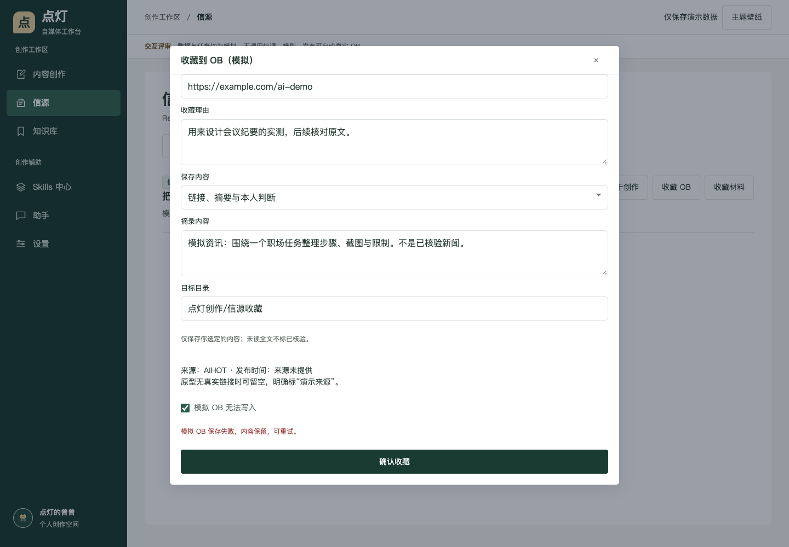
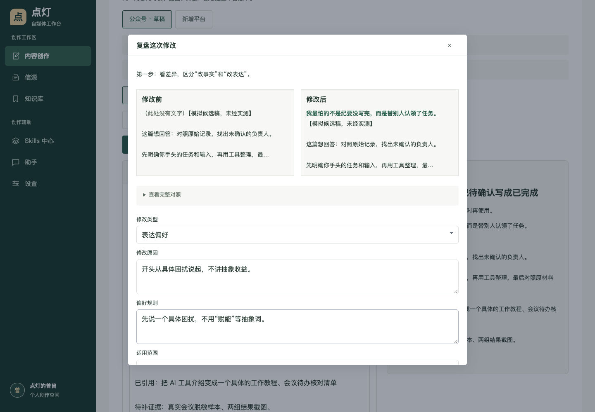
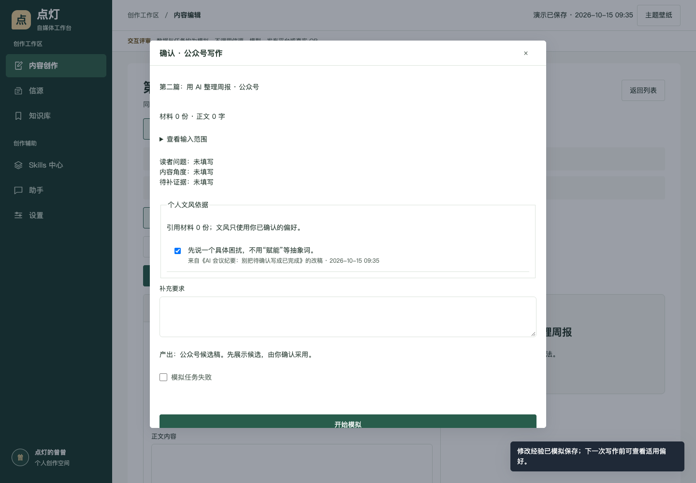
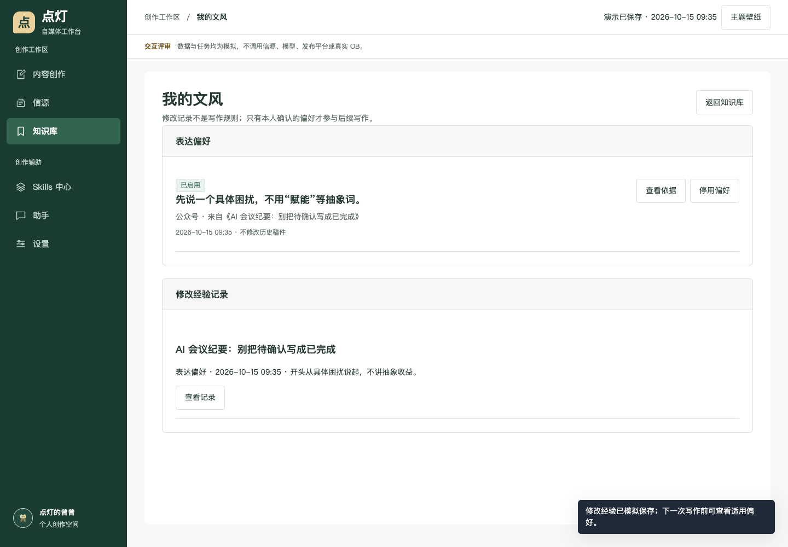
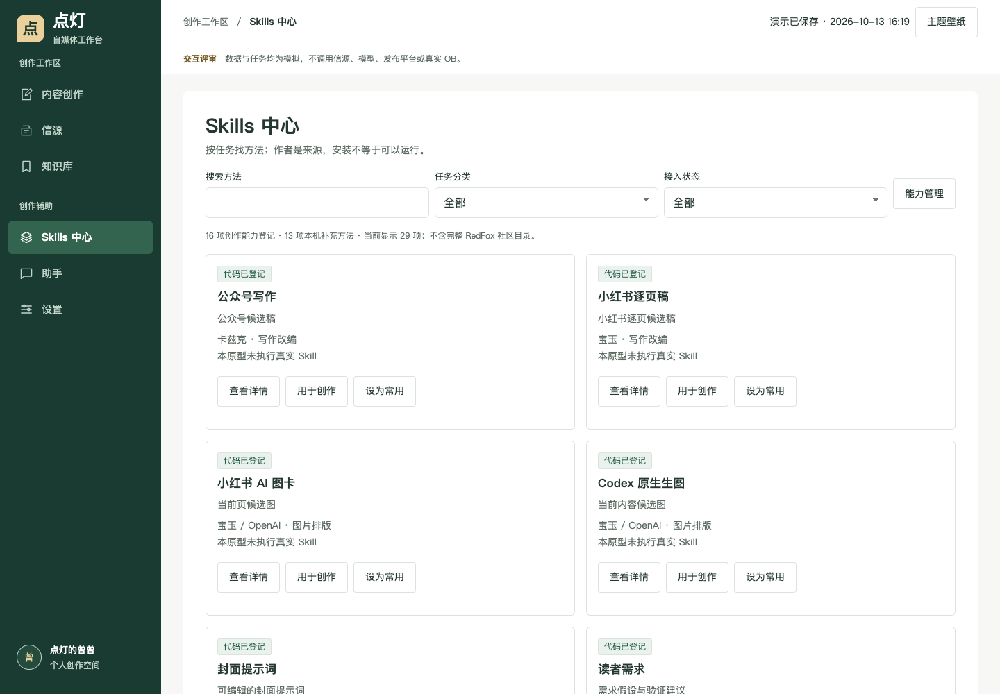
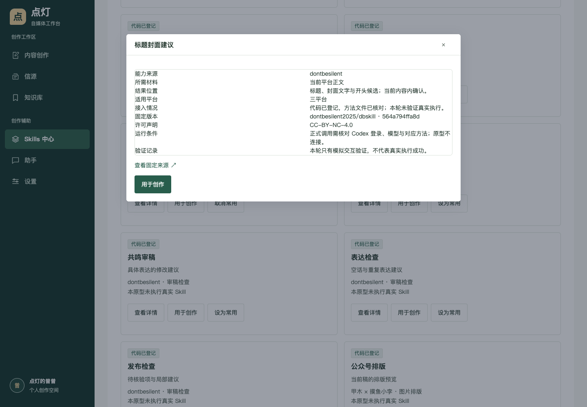
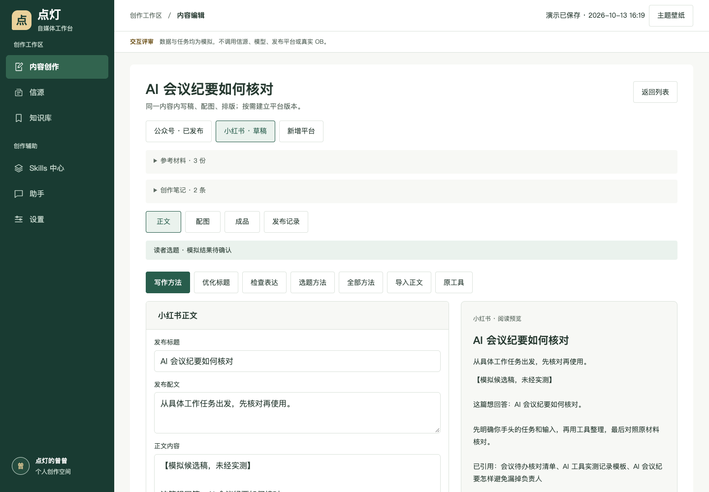
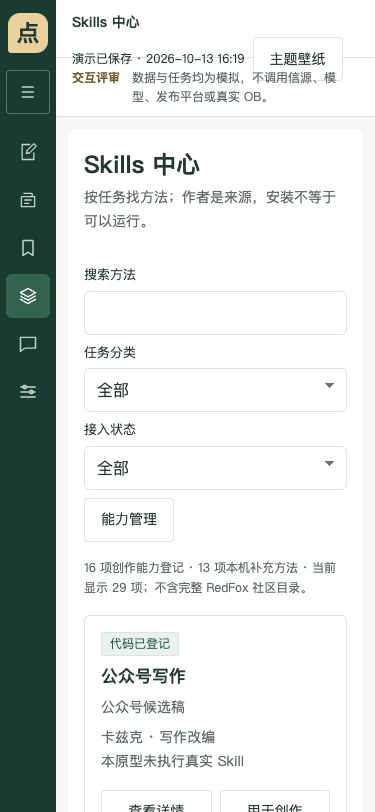

# 点灯工作台：统一创作交互验收

更新日期：2026-10-15。范围：隔离 HTML 原型的交互，不是正式系统修复或视觉定稿。

设计依据：[功能归属与关键交互](功能归属与关键交互-点灯工作台-2026-10-13.md)。入口：[打开原型](http://127.0.0.1:8098/index.html#content)，需本机静态服务运行，无需登录。

## 已完成的交互

| 范围 | 检查结果 |
|---|---|
| 左侧入口 | 三个主入口、三个辅助入口；选题与发布状态回归内容列表 |
| 内容创建 | 一句话直达编辑器；标题为空提示；可从外部资讯和 OB 导入 |
| 引用关系 | 多份笔记加入一篇内容，重复引用不重复添加，正文不被改写 |
| 平台版本 | 公众号、小红书、抖音图文按需建立，切换后保留独立正文 |
| 能力发现 | 16 项登记能力与 13 项待接入方法分别呈现，可搜索、分类和收藏 |
| 能力边界 | 待接入项无执行按钮；固定来源、许可和本轮未真实执行均可查看 |
| 候选与失败 | 模拟生成、失败重试、采用、放弃、下载；原稿已变时禁止覆盖 |
| 配图 | 添加页面、上传、模板占位、模拟 AI 配图、上移；单页失败不清空其他页 |
| 成品 | 核对文字与图片、查看预览、导出示例 HTML；不冒称 PNG 成品包 |
| 发布与反馈 | 日期选择、重复链接保护、版本快照；空数据与零分开记录 |
| OB 归档 | 模拟路径预览与附件失败恢复；不写真实知识库 |
| 演示存储 | 刷新恢复，损坏原存档保留，保存前另行备份 |
| RedFox 回归 | 搜索条件、条数、缓存、详情恢复、账号追踪、原创作与损坏存档恢复 |

通过真实浏览器点击检查，不用 DOM 数量代替主路径：桌面 1440 × 1000、平板 768 × 900、手机 375 × 812；核心页面无页面级横向溢出，弹层可关闭、手机左侧菜单可展开；验收期间无页面脚本异常和外部服务请求。

## 评审截图

### 新增：信源积累与个人文风

本轮任务完成情况：

- 已补入主方案：资料收藏、内容角度、改稿经验和下一篇写作的对象与交互规则。
- 已补入原型：三个信源收藏、知识库回查、前后差异、本人确认与停用、生成前单次选用。
- 已走通完整任务：从来源建立第一篇，完成图文与归档，再用第二篇验证偏好是否进入输入。
- 视觉美化和正式功能开发未开始；本轮只做基本布局截图检查，不作为完整视觉审查结论。

收藏理由由本人填写；失败后输入保留，同来源或同原文链接不会重复存笔记。三类来源均通过模拟收藏检查，原 RedFox 快速收藏继续保留。

先看改动段落，可展开全文对照；事实纠错不转成文风。表达偏好需本人填写、选择范围并确认启用。保存失败不丢对照，不产生半条偏好记录。

第二篇公众号任务能看到第一篇确认的规则及来源，可单次取消；小红书不会自动使用公众号专属偏好。未启用不使用，停用不改变旧文章或旧任务记录。

外部资料、修改经验、文风偏好、成品归档在知识库分别可查。“我的文风”是知识库子页，不新增一级导航。归档成品可再次找到，不只显示一个路径提示。

新增场景使用实际浏览器逐步点击检查；同时检查 1440 × 1000、768 × 900、375 × 812 下的偏好页面与对照弹窗，无页面级横向溢出和页面脚本异常，未请求真实外部服务。

下列旧截图记录统一导航与能力目录的前次布局；新增学习交互以上述 2026-10-15 截图为准。

### Skills 中心

能力按任务与状态筛选，作者是来源，不能把已安装当作已运行。待接入方法完整可查，但不提供假运行操作。

详情说明输入、结果、平台、固定来源与验证边界；从中心使用时选择目标内容，从编辑器使用时继承当前稿件。

### 同一内容内编辑

参考材料、平台版本、正文与预览围绕同一篇内容；配图与发布记录是内容内操作，非新的独立业务库。

### 窄屏检查

窄屏保留左侧导航，可展开文字菜单；筛选和操作换行，不把整页横向挤出屏幕。

## 未完成，不能算验收通过

1. 真实模型、生图、信源、OB 和平台后台操作均未接入。所有生成结果为预置逻辑模拟，不用于判断内容质量。
2. 原 RedFox 创作工具仍以兼容页面保留；结果可以引用回当前内容，尚未将其所有控件融入统一编辑器。
3. 完整 Skills 安装更新、热榜绑定、自定义编辑、知识连接管理、Agent 对话、账号表达设置与视频尚未细化成交互。这些正式能力未删除，但本轮不宣称原型已全覆盖。
4. 内置壁纸图库、视觉精修、完整图片包与正式数据迁移尚未进行。既有主题与壁纸上传仅保留原交互。
5. 当前是供产品评审的核心路径版本；下一步先确认交互和补齐必要辅助路径，再进行视觉美化与正式开发。

## 复验入口

- [统一交互验收脚本](prototypes/creator-flow-v1/verify-unified.cjs)：新流程与能力目录、候选、配图、发布、归档、尺寸检查。
- [完整使用任务验收](prototypes/creator-flow-v1/verify-learning.cjs)：三信源收藏、选题角度、改稿差异、下一篇偏好使用与取消、同一内容成品归档回查。
- [原功能回归脚本](prototypes/creator-flow-v1/verify-redfox-recovery.cjs)：原搜索、缓存、追踪、创作和数据恢复。
- [原型使用说明](prototypes/creator-flow-v1/README.md)：当前入口、试用步骤及历史版本边界。

验收使用仓库现有浏览器测试依赖和本机 Chrome，临时浏览器与临时服务隔离；没有改正式账户、凭据、笔记和现有未提交开发文件。
