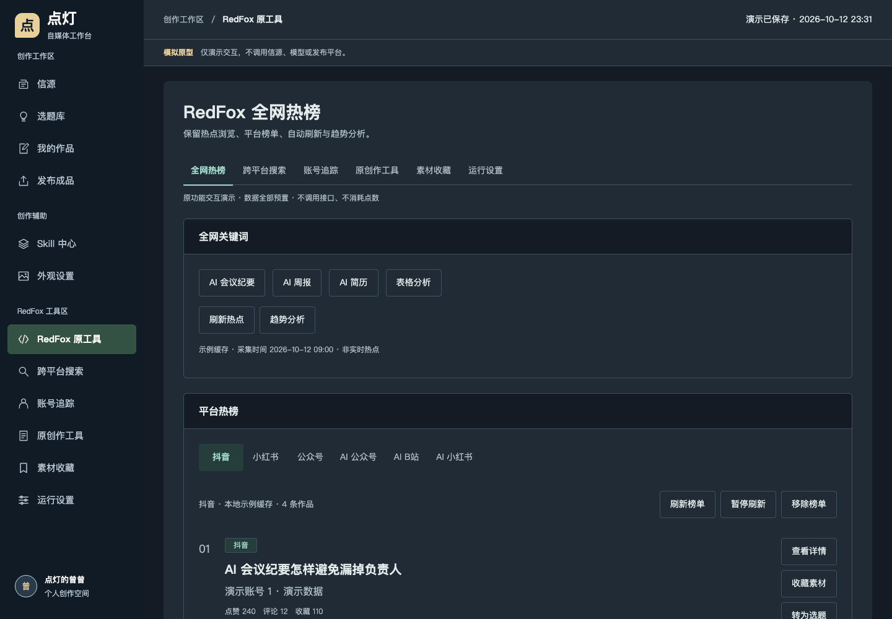
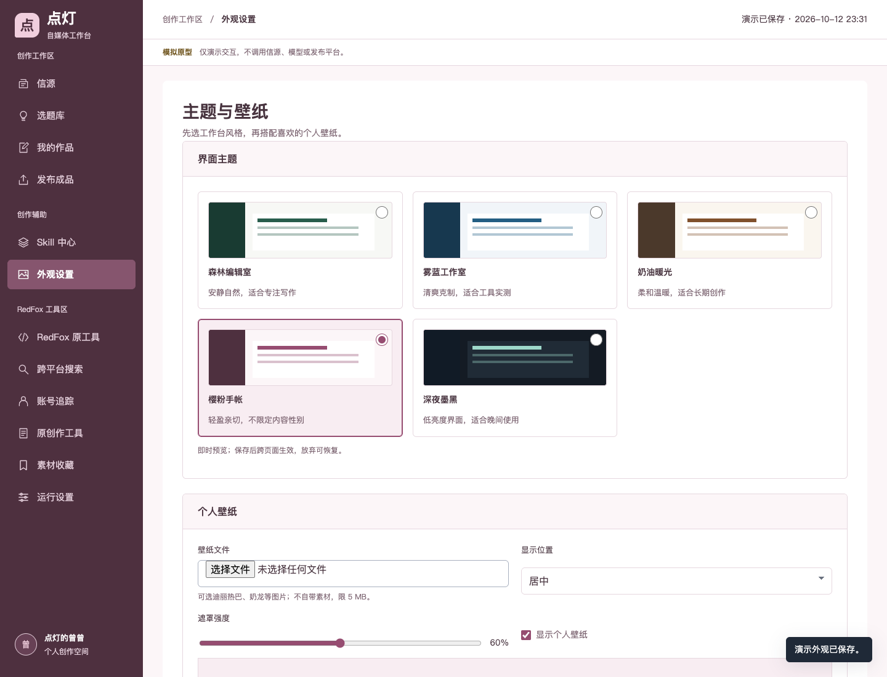
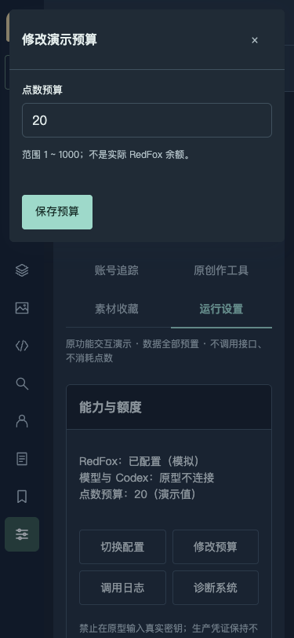

# 原型评审：RedFox 与主题

日期：2026-10-12。范围：独立模拟原型，未改正式服务、RedFox 接口、凭证、任务计划或数据。需求唯一维护位置为 [PRD 1.4](PRD-点灯自媒体工作台.md) 第 3.9、6.1 节，本文只记录实现与验证证据。

## 1. 设计修正

用途：让点灯的曾曾从原有热点、搜索、账号与创作工具进入新图文主线，不丢掉原操作入口。视觉方向：保持左侧菜单与克制的编辑工作区，主题和壁纸由个人选择。记忆点：五种完整界面配色，不让壁纸或深夜主题改变成品纸面。

沿用项目内 PUI 母版的列表、详情、编辑、配置模板及弹窗、输入、选择、状态控件。未引入新组件库、外部字体或在线图片。RedFox 操作不是一比一复制旧视觉，而是保留已确认的主要操作关系。

| 问题 | 修正 | 证据 |
|---|---|---|
| 原工具只有保护说明，无法点击评审 | 新增热榜、搜索、详情、追踪、原创作、收藏、运行设置 | 新 RedFox 主路径自动复验 |
| 只有壁纸，没有完整主题 | 森林、雾蓝、奶油、樱粉、深夜五主题；预览、保存、放弃、刷新恢复 | 五主题实际渲染与输入对比度检查 |
| 查询后筛选回显丢失，缓存提示不准确 | 保留平台与条数，缓存区分完整条件和有效期 | 条件变化、绕过缓存、模拟过期复验 |
| 原创作仍漏了“创作”模式 | 补主题大纲与创作模式，保留改写及其他原工具 | 创作确认与候选模拟通过 |
| 追踪作者后被旧分组隐藏 | 添加、追踪与编辑后显示全部账号 | 先选“自己”再追踪，新增账号可见 |
| 损坏记录可导致空白页 | 校验记录结构，提示并保留原档，保存前建立备份 | 损坏账号记录的独立复验 |

## 2. 页面证据

### RedFox 工具区

点击平台榜单、作品详情、收藏、追踪和转选题可连贯操作。原工具创作结果与新主线作品区分，转入选题需要确认，未偷偷运行真实模型。

### 五套可选主题

其他实际截图：[森林](assets/redfox-theme-forest-2026-10-12.png)、[雾蓝](assets/redfox-theme-blue-2026-10-12.png)、[奶油](assets/redfox-theme-cream-2026-10-12.png)、[深夜](assets/redfox-theme-night-2026-10-12.png)。全页使用共同语义配色，成品模板颜色单独保留。

### 手机与弹窗

左侧图标栏、文字抽屉、弹窗背景隔离与 Escape 关闭维持原规则。其他截图：[平板热榜](assets/redfox-hotlist-768-2026-10-12.png)、[手机热榜](assets/redfox-hotlist-375-2026-10-12.png)。截图采用浏览器视口，避免整页拼接造成固定侧栏错位；截图不代替功能验证。

## 3. 验证结果

- 原有 `verify-design.cjs`：21 组通过，覆盖图文主线、手改保护、单端失败恢复、成品检查、发布快照、壁纸、存储异常及左侧菜单；未改旧测试。
- 新 `verify-redfox-themes.cjs`：热榜、搜索、详情、收藏、追踪、四类工具、配置及主题主路径通过；五主题 × 八个页面 × 三种宽度，共 120 种组合无页面横向溢出。实际输入文字与表面对比度均达到 4.5，未据此宣称完整无障碍合规。
- 新 `verify-redfox-recovery.cjs`：筛选回显、条数改变、模拟缓存过期、详情刷新、追踪分组、原创作模式、损坏存档保留与备份通过。
- 1440、768、375 三种宽度在真实本机 Chrome 检查；无未捕获页面异常和外部请求。独立只读审查提出的四项问题修正后复验通过，未发现新的阻断项。
- 生产工作区既有未提交变更不纳入本轮；交付只包含原型、对应需求和新增验收证据。

## 4. 未验证与边界

未接入或验收真实 RedFox、模型、Codex 生图、OB 写入、自动发布、余额、通知或生产失败恢复。本轮可点击不等于正式系统可用。评论数量有现有代码依据，未找到 RedFox 评论全文实现；小红书 MCP 是独立依赖。

账号评分／曲线、通知配置、封面结果仅模拟或提示；动态 Skill 绑定热榜及完整原知识库尚未细化，正式能力保留。未执行跨模型外部审查、跨浏览器兼容和完整无障碍认证，也不承诺涨粉效果。
