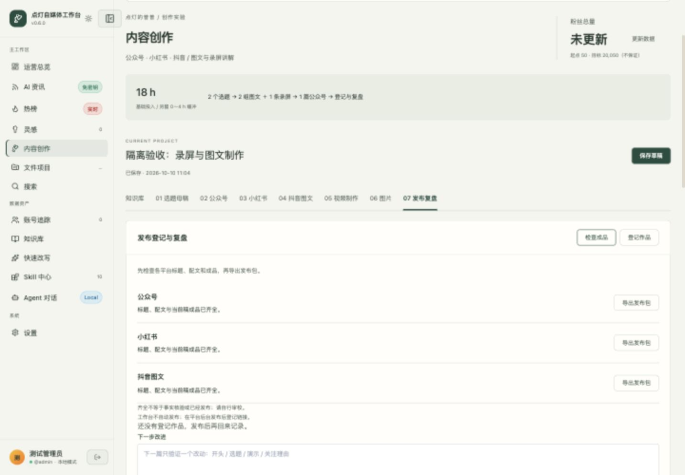
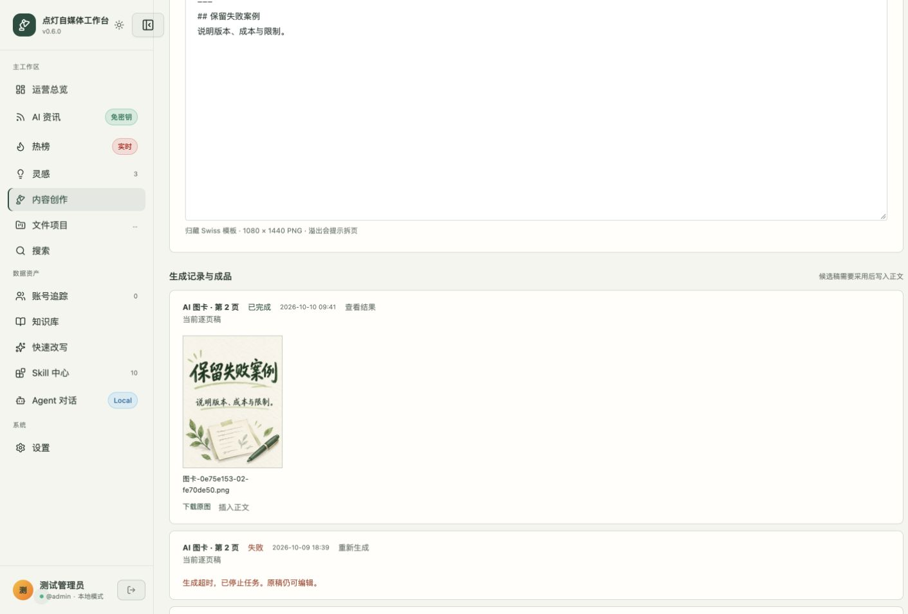
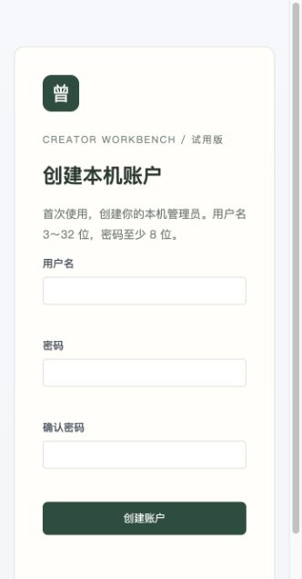

# 点灯自媒体工作台操作手册

给「点灯的曾曾」使用：把真实 AI 实测整理成公众号、小红书图文、抖音图文和录屏成片，再保存发布记录与复盘。OB 指 Obsidian，你的笔记与知识库软件。

第一次只需先看第 1～3 节；开始真实创作时看第 4～8 节，出问题再查第 9～10 节。

**统一入口：[点灯自媒体工作台](http://127.0.0.1:8080)。** 登录后进入「内容创作」；旧 `/workbench.html` 书签会自动转到同一系统。

2026-10-09 更新：灵感熔炉已改名并融入个人创作能力，共用导航、登录与本机服务。已有本机账户，不需重复初始化；本轮没有替你登录正式账户或发布内容。真实 AI 验收使用独立测试账户与演示素材。

最短创作路径：**选题立项 → 实测与母稿 → 分平台生成整稿或手写 → 采用保存 → 排版／出图／录屏成片 → 检查成品与导出 → 自己发布 → 复盘归档。**

不用先买 RedFox API。新增 AI 资讯、Codex 写作与生图不依赖 RedFox；原有三平台热榜、自动搜索及账号抓取仍需要原服务配置，不能把这些模块的未配置误认为整个平台不可用。

## 1. 入口在哪里

| 入口 | 用来做什么 | 怎么打开 |
| --- | --- | --- |
| 网页工作台 | 整理素材、写三端稿、排版、生图、导出、复盘 | 点击上面的工作台链接 |
| OB 创作首页 | 记灵感、记实测、建母稿、阅读资讯、找笔记 | 打开「自媒体知识库」，进入「创作」页签 |
| 原有功能 | 热榜、灵感、搜索、账号追踪、知识库与 Agent | 同一工作台的左侧导航，不用打开另一个网站 |

从 OB 打开：创作首页 →「创作」→「网页工作台」。首页的「使用说明」先打开首页说明，开头另有本操作手册链接。也可按 `⌘ O` 搜索「点灯自媒体工作台-操作手册」。找不到首页时，按 `⌘ P` 搜索「乔木Home」。

工作台仅在这台 Mac 本机使用。手机打开同一地址不会进入这台电脑；也不要双击 `workbench.html` 当普通文件打开。常驻服务已经安装，正常登录电脑后不用每次启动终端。

## 2. 首次试用：先不调用 AI

### 2.1 登录同一个账户

当前看到「登录」时，使用自己创建的本机用户名和密码，点「进入工作台」。这是平台的本机账户，不是微信、抖音或 ChatGPT 账户；不用重新创建另一套账户。正常登录在网页输入密码；第 10 节重置密码由本人在终端交互输入，均不发给 Codex。

登录用户名以首次初始化时填写的内容为准，显示名称不能代替用户名。本公开手册不记录个人账户信息；已有账户无需重新创建。

只有新安装且没有账户时，才会出现「初始化工作台」：

1. 填写「显示名称」和「登录用户名」；用户名 3～32 位。
2. 填写 8～128 位密码，再填写「确认密码」。
3. 「内容工作区」用于接入原有 Markdown 文件项目，没有现成目录可留空；它不是 OB 连接设置。
4. 点击「创建并进入」。后续使用同一账户登录，OB 连接在「内容创作」里单独设置。

忘记密码按第 10 节由本人重置，不要删库或重建账户。已有账户却突然看到「初始化工作台」时先停止填写，请 Codex 核对服务与数据目录。

### 2.2 用示例认路

1. 还没有任何内容时，点击空状态里的「载入示例」。它会创建一篇演示项目，不会调用 AI。
2. 页面进入「02 公众号」。点击「排版预览」，看到排版后可点「导出 HTML」保存；关闭预览即可回到编辑器。
3. 切到「03 小红书」，点击「导出卡片」。这一步使用本机模板，不调用 AI 模型。
4. 向下找到「生成记录与成品」，等待「文字卡片 · 非 AI 生图」显示「已完成」，点击各页的「下载原图」。
5. 你应得到公众号 HTML 和图文 PNG。保存位置以浏览器下载提示为准。

示例用于认识按钮，含「待验证」内容，不能原样发布。已有项目时不显示「载入示例」；可点「新建内容」，创建标题为「排版测试」的项目，手填两段正文和第 5.2 节的两页格式示例，再分别预览和导出，不用删除已有项目来恢复示例按钮。卡片导出失败可看第 9 节，不必反复点击。

## 3. 界面怎么用

左侧是整个系统的导航；进入「内容创作」，页面上方「我的内容」才是稿件列表。点标题切换稿件，点「新建内容」建立稿件。步骤页签和稿件列表在窄窗口可横向滚动；任务结果在下方「生成记录与成品」。

- 「AI 资讯」：卡兹克 AIHOT 精选、乔木精选频道和官方 RSS，不要求 RedFox 密钥。可按信源或关键词筛选；「加载更多」继续阅读。
- 资讯卡「转为选题」：带入短摘要、来源、作者和原文链接，同一资讯再次点击打开已有稿件，不覆盖人工修改。报道不等于你已做过实测。
- 「信源状态与使用限制」：查看各频道是否可读、最近成功时间与错误；失败时保留已有缓存。点击「刷新信源」重试，间隔至少 60 秒。
- 「Skill 中心」默认显示 10 项创作能力。用途、作者、来源仓库、版本、许可与适配方式统一放在卡片里；「查看来源」打开对应版本的 Skill 原文。创作页不再单独设置「能力来源」弹窗。

### Skill 中心怎么调用

先新建或打开内容，再去「Skill 中心」点击「用于创作」，回到同一稿件后点「运行能力」。核对当前稿件，不要把另一篇的材料带入任务。

Skill 中心是选方法的入口，不是每次生成的必经步骤。已在编辑器中时，可直接点「生成整稿」「AI 图卡」「Codex 生图」或「排版预览」，与相应能力使用同一执行路径。

来源缺失时「用于创作」不可点；信息读取失败时点击顶部「刷新」重试。源码保留在本地，不执行上游安装脚本；任意下载的 Skill 不会自动获得执行权限。db 仅供个人非商业使用，商业化或分发前须核查许可。

| 创作能力 | 用途 | 结果 |
| --- | --- | --- |
| 公众号写作 · 卡兹克 | 从真实材料写初稿 | 审核后采用 |
| 小红书逐页稿 · 宝玉 | 将一个结论拆成封面与内容页 | 审核后采用 |
| 小红书 AI 图卡 · 宝玉 / OpenAI | 确认逐页稿后单页出图 | 原图与本页提示词 |
| Codex 原生生图 | 按图片提示词出图 | 原图 |
| 封面提示词 · 宝玉 | 整理主体、风格与构图要求 | 采用后填入图片提示词 |
| 内容价值检查 · dontbesilent | 查读者所得和证据缺口 | 修改建议，不自动改稿 |
| 标题开头建议 · dontbesilent | 三组标题与开场 | 建议，需人工选用 |
| 公众号排版 · 甲木 × 摸鱼小李 | 石墨极简排版 | 预览、复制或导出 |
| 文字卡片导出 · 归藏 | 本机模板排版 | PNG，非 AI 生图 |
| Obsidian 归档 · Kepano | 保存独立成果快照 | 确认后归档，不覆盖原笔记 |

写作与图卡是上游方法的工作台适配，不代表运行所有上游脚本或完整对话流程。RedFox、本地自定义及社区能力保留在其他页签，执行条件各不相同。

首次调用 AI 前，在「内容创作」点「检查能力」。本机 Codex CLI 必须已安装并由你登录 ChatGPT 账户；显示未安装时请 Codex 协助核对路径，登录失效时由你在终端运行 `codex login`。检测可提交条件，不保证额度或网络；不需要额外购买 RedFox 或填写 OpenAI API 密钥。

- 「灵感」→ 选题卡「开始创作」：带入摘要、角度、关键词与参考证据；同一来源再次点击会打开已有稿件，不覆盖修订。
- 「搜索」或侧栏「知识库」→「发送创作」：把所选参考资料转入稿件；原资料不改动。
- 「文件项目」：保留原 Markdown 目录工作流与检查、推进能力；不同于「我的内容」中的编辑稿件。
- 「快速改写」：保留原敏感词检测、改写等工具；所需外部服务在「设置」配置。
- 侧栏「知识库」用于浏览资料；稿件内部的「知识库」页签用于本篇 OB 引用和归档。

| 工作区 | 你需要准备 | 主要操作 | 得到什么 |
| --- | --- | --- | --- |
| 知识库 | 已整理的 OB 笔记、母稿 | 预览、选为素材、导入稿件 | 本篇引用、候选稿 |
| 01 选题母稿 | 读者问题、真实实测、来源 | 推荐选题、导入正文、生成母稿 | 可立项选题、事实母稿 |
| 02 公众号 | 母稿与实测证据 | 生成整稿、排版预览、导出文稿 | 标题、摘要、正文、HTML |
| 03 小红书 | 一个清晰结论与步骤 | 生成整稿、AI 图卡、导出卡片 | 标题、配文、逐页稿、有序图片 |
| 04 抖音图文 | 结果与最短步骤 | 生成整稿、导出卡片 | 独立图文稿、配文、PNG |
| 05 视频制作 | 真实录屏、讲解、字幕 | 生成整稿、导入录屏、生成成片 | 脚本与可播放 MP4 |
| 06 图片 | 图片用途与提示词 | 填入提示词、Codex 生图、导入图片 | 配图原图 |
| 07 发布复盘 | 各平台成品、实际数据 | 检查成品、导出发布包、登记作品 | 发布包与表现记录 |

### 保存、生成、采用是三件事

- 修改后点「保存草稿」，看到「已保存 · 日期时间」才算落盘。离开内容创作、切换稿件或刷新工作区前会尝试保存；保存失败会阻止切换并保留编辑。不是逐字自动保存，关闭或刷新浏览器前仍应主动保存。
- 生成文字后，向下找到对应任务 →「查看结果」→ 核对 →「采用稿件」。公众号、图文、视频及封面提示词候选可以采用；选题建议可点「创建选题」建立独立项目；开头与检查不自动改稿。
- 「采用稿件」会替换对应编辑区的内容，采用前先读完整结果；需要保留旧稿时先「导出文稿」或「导出脚本」。
- 不满意就关闭预览，原稿不变；也可「复制结果」，手动摘取需要的部分，再保存草稿。
- 生成后又修改过原稿，旧候选稿可能无法采用。这是在防止覆盖新内容，复制后手动合并即可。
- 同时只运行一个生成或卡片导出任务。生成中仍可改草稿，但不要重复提交；修改会影响旧候选稿的采用。

## 4. 做第一篇真实内容

推荐选一个你真的用过的 AI 工具，回答一个产品工作中的具体问题，例如「AI 能否帮我发现需求评审中的遗漏」。不要从罗列工具功能开始。

### 4.1 先在 OB 准备证据和母稿

1. 从已有主题、观点和学习卡查资料，核对原文，不把 RSS 中文摘要当作测试结果。
2. 在 OB 首页点击「记实测」，记录工具版本、日期、输入、操作、结果、失败案例、成本和截图。
3. 点击「建母稿」，先写一个完整结论：谁遇到什么问题、你怎样测试、得到了什么、哪些情况不适用。母稿就是同一个选题的完整底稿，三端都从它改写。

三个 OB 入口只是创建模板，不会自动代写，也不会自动在网页建立项目。网页已有「事实母稿」工作区；OB 母稿可继续放在 `03-内容创作/通用/`，再粘贴或通过「导入正文」带入网页。

### 4.2 在网页建立内容

1. 点「新建内容」，填写「内容标题」和「读者问题」，点「创建内容」。标题必填，最多 120 字符。
2. 在「01 选题母稿」填写「目标读者」「实测素材」「参考来源」。写明真实结果，未做的测试标「待验证」。
3. 点「保存草稿」。如果想复用 OB 母稿和实测笔记，按第 7 节连接并「选为素材」。
4. 需要选题辅助时点「推荐选题」，查看结果里的读者问题、验证动作与理由，点「创建选题」建立独立项目；重复点击会打开同一个项目。
5. 按第 5 节分别准备三端稿。文字生成需要「实测素材」「事实母稿」或本篇关联的 OB 文字；普通生图需要「图片提示词」；AI 图卡需要已确认的逐页稿。

没有选题时，先打开「AI 资讯」阅读原文，再「转为选题」。系统只带入短摘要，不会自动测试工具或核实报道；补足证据后才能写成实测内容。当前不自动扫描整个 OB 的 RSS 收件箱，网页读取的是已接入的公开信源。

未实测也可以做资讯解读：在「实测素材」写清读者问题、已核对的来源摘要、自己的判断，并注明「未实测」。不得让生成稿把资讯改写成本人的测试经历。

### 4.3 发布前自查

- 开头能否马上说明读者问题或展示真实结果？
- 每个结论是否有实测、来源或明确的「待验证」标记？
- 操作是否能复现，版本、日期和成本是否交代？
- 是否有自己的判断、失败案例与适用边界，而不只是工具宣传？
- 去掉空话与像广告的夸张承诺，图片不冒充真实工具截图。

可在「01 选题母稿」点击「检查内容」辅助审校；建议不会自动改稿，也不能替代你核对事实。

已有文章可以直接填「事实母稿」，或点「导入正文」粘贴、读取不超过 200 KB 的 Markdown／TXT。导入先成为候选稿，确认采用后才替换所选正文，不会修改本机原文件。Word、PDF 与网页全文暂不直接导入。

## 5. 图文和视频怎么产出

### 5.1 公众号：初稿 → 采用 → 排版 → 手动上传

1. 在「02 公众号」点「生成整稿」。到下方「查看结果」，审核后点「采用稿件」。已有自己的稿件也可直接粘贴编辑，不必调用 AI。
2. 分别填写发布标题、文章摘要，修改正文并保存。支持普通 Markdown，例如 `## 小标题`、列表、引用和 `**重点**`；当前石墨极简主题会把重点显示为下划线。
3. 点「排版预览」检查，再点「复制排版」。到公众号后台粘贴正文；文章标题和摘要分别使用编辑器中的对应文本。
4. 图片在公众号后台重新上传，检查手机预览，再由你自己发布。工作台里的本机图片地址需要登录，不能当成读者可访问的公众号图片。

「导出文稿」保存 Markdown 文字，不是富文本排版；「导出 HTML」在排版预览弹窗里。浏览器不支持富文本复制时，导出 HTML、打开后复制正文，并在后台检查样式。不要直接粘贴 OB 查询、Bases、嵌入笔记或原始 HTML，期待自动转换。

### 5.2 小红书：逐页稿 → 模板卡片 → 手动发布

1. 在「03 小红书」点「生成整稿」，审核后「采用稿件」，或自己填写逐页稿。
2. 每页以 `## 短标题` 开头，用单独一行 `---` 分页。保存后点「导出卡片」。
3. 到下方任务记录，下载各页 PNG，按页码顺序上传到小红书；发布标题和配文在本页单独编辑；「生成整稿」会同时提供标题、配文和逐页稿。

最小格式示例，仅用于测试排版：

```markdown
## 先确认读者问题
这一页只说清一个具体问题。

---

## 再展示真实结果
- 写清工具版本。
- 展示结果和失败案例。
```

卡片想用于公众号时，可直接在公众号后台上传下载的 PNG，插入需要的位置，再检查手机预览；不必先调用生图。

限制：1～8 页，每页标题最多 18 字符，正文最多 160 字符（包括标点和 Markdown 符号）。仍可能因布局过满报错；按提示减少文字或拆页，不要用不可读的小字。成品是固定模板卡片，不是 AI 生图；当前不会自动把「06 图片」的配图混排进卡片。

### 5.3 抖音图文：独立成稿 → 卡片 → 发布包

1. 打开「04 抖音图文」，点「生成整稿」，核对后「采用稿件」；也可直接输入或导入已有逐页稿。
2. 分别填写「发布标题」「发布配文」；每页用 `## 短标题`，独立 `---` 分页。
3. 保存后点「导出卡片」，下载各页 PNG。抖音图文与小红书稿件分别保存，不会互相覆盖。
4. 到「07 发布复盘」点「检查成品」，补齐缺失项，再点「导出发布包」。

### 5.4 视频制作：录屏＋本人讲解 → MP4

1. 打开「05 视频制作」，点「生成整稿」，采用视频标题、发布配文与录屏脚本；也可手写脚本。
2. 用 Mac 的 `⇧⌘5` 或自己的录屏软件录下真实操作。点「导入录屏」，支持 MP4／MOV，不超过 200 MB。
3. 如录屏已包含本人讲解，可保留录屏声音。另录配音时点「导入配音」，支持 MP3／WAV／M4A，不超过 30 MB；选择配音后会替换录屏原声，不是混音。
4. 选择本篇录屏与配音，填写「开始秒数」「结束秒数」。结束留空用原片末尾；单条成片最长 300 秒。配音从第 0 秒开始，必须覆盖截取后的成片时长。
5. 选择竖屏 1080 × 1920 或横屏 1920 × 1080。画面等比放入画幅，不裁掉工具界面；空余区域补深绿色背景。
6. 可粘贴 SRT 字幕，从成片第 0 秒开始计时。每段最多两行，每行 24 字；不支持格式标签，不能重叠或超出成片时长。字幕可留空。
7. 点「生成成片」，到下方「录屏成片」任务等待完成；完整播放并检查声音、字幕与画面，再下载 MP4。字幕会烧录到画面，不依赖播放器开关。
8. 在平台后台自己上传视频，回到「07 发布复盘」登记链接。已有成片仍可用「导入成片」归档，MP4 上限 100 MB。

字幕示例（用于 2 秒或更长的成片）：

```srt
1
00:00:00,000 --> 00:00:02,000
先给出一个真实结果。
```

本机需要 FFmpeg 和 ffprobe；字幕可用 libass 或本机 Chrome 文字画布。生成前会检查环境，不会因为缺依赖就伪装成片成功。可通过 `FFMPEG_BIN`、`FFPROBE_BIN` 配置工具路径；本机素材不上传视频供应商。

当前支持单段截取、替换配音、画幅适配和字幕烧录，不自动录屏、转写、生成配音、多镜头智能剪辑或从文字生成 AI 动画。字幕需要自己校对与对时。原录屏、配音和旧成片保留，失败时调整参数重试，不覆盖源文件。

### 5.5 小红书 AI 图卡：先确认稿，再单页生成

1. 在「03 小红书」生成并采用逐页稿，检查每页事实、短标题与字数。
2. 点「AI 图卡」，核对读者、暖白深绿手绘风格和 3:4 画幅，在「生成页面」选择第 1 页，点「确认生成」。
3. 等下方任务完成，查看封面的文字与构图，下载原图。
4. 再点「AI 图卡」，选择第 2 页；工作台会将当前逐页稿最新成功的封面作为风格参考。后续页依次操作，不会一次自动扣费生成整套。
5. 修改逐页稿后须重新生成本套封面；不能把旧稿封面直接用于新稿内容页。

同样限制 1～8 页、标题 18 字符、正文 160 字符。原生图片会保存各页提示词、分析与逐页稿记录；文字可能出错、风格可能漂移，必须检查，不能保证每次完美。先用少量文字试一张，再继续整套；普通「导出卡片」是另一条无模型费用的模板路径。

任务标题显示页码，下载文件名区分稿件、页码与生成批次。标为「旧稿图片」的不要混用；重新生成封面后，参考旧封面的内容页会提示重做。第二页失败不会删除成功的封面，点该任务「重新生成」会重新打开同一页的确认窗口；以当前保存的逐页稿为输入。

## 6. Codex 生图怎么用

1. 打开「06 图片」，选择画幅、色调和风格。
2. 点「填入提示词」，再修改「图片提示词」，说清封面或配图用途、主体和禁忌。
3. 点「Codex 生图」，到下方等待任务完成。它可能需要几分钟，不要重复点击。
4. 点击「下载原图」。需要放进公众号时点「插入正文」，它只追加到公众号正文；检查位置后再点「保存草稿」。

画幅等选项通过「填入提示词」写进文字；改了选项，要重新填入并检查提示词，旧提示词中的选择不会自动更新。生成结果不保证精确像素尺寸，发布前自行核对和裁剪。

已有图片可点「导入图片」：仅支持 PNG/JPEG，单张不超过 1 MB；这不是 Codex 生成图或卡片导出的大小上限。没有可用的图片返回时任务会标失败，不会拿模板卡片冒充 AI 图片。

「检查能力」会检查 CLI、登录和生图开关；这只表示具备提交条件，不保证网络、额度或任务成功。工作台通过本机已登录 Codex CLI 调用原生 image_gen，不是网页直接获得本次聊天的工具权限；不要求另填 OpenAI 或 RedFox API 密钥。每次任务仍以成功记录和原图为准。

生图结果会核验本次任务的原生图片证据，不能复用历史图片冒充新生成。文字任务只读，图片任务只允许任务目录写入；不载入用户 CLI 的自定义服务配置，也不把工作台 API 密钥传给子进程。本机登录需由你自己处理，勿把登录凭证发到聊天。

## 7. OB 与网页怎样配合

### 7.1 首次连接

在侧栏进入「内容创作」，点页面上方「连接知识库」。若已经连过，先核对现有设置，不必重复连接。

「知识库路径」填写自己的 Obsidian 库完整路径。以下为示例，需替换为实际位置：

```text
/Users/你的用户名/自媒体知识库
```

「接入目录」每行一个，先用已有的三个目录：

```text
02-素材库
06-知识学习
03-内容创作
```

「归档目录」填写：

```text
03-内容创作/点灯创作台
```

点击「连接知识库」。这只保存本机接入设置，不搬动笔记、不安装插件，也不自动把整个库上传。默认范围不包含日记和 Raw 收件箱；RSS 保存的文章先核对、学习并整理成卡片，再用于创作。只连接你确实愿意用于创作的目录。

### 7.2 给当前内容选择素材

1. 新建或打开一篇内容，进入「知识库」。
2. 用文件名或路径中的关键词搜索，不是全文或语义搜索；最多显示前 100 篇，结果过多就缩小关键词。
3. 点击「预览」，确认内容后点「选为素材」，在「本篇关联」检查引用。
4. OB 原文修改后显示「原文已改」，点「刷新引用」才会更新这篇内容的素材快照，不会改已采用的正文。「移除」只移除引用，不删除原笔记。

每篇内容最多关联 8 篇笔记；单篇最多 30,000 字符，所选正文合计最多 60,000 字符。暂不展开 PDF、嵌入笔记、查询、Bases 或 Excalidraw 内容；先整理成文字学习卡，白板图片另行导入。

文字生成会向 Codex 及其模型服务发送账号定位、标题、目标读者、实测素材、参考来源、所选笔记正文，以及对应稿件（为空时使用现有三端稿之一）；事实母稿也会发送；不发送整库、发布指标或全部历史任务。普通生图使用图片提示词，AI 图卡使用已确认的本页文字及封面参考图。均可能消耗额度，不输入客户机密、密码或未授权资料。

### 7.3 在 OB 改稿，再带回网页

在网页「知识库」找到改好的笔记 →「预览」→「导入稿件」→ 选择「公众号 / 小红书 / 抖音脚本」→「导入稿件」。它先成为候选稿，核对后点「采用稿件」；不会直接覆盖当前正文。

「选为素材」是给 AI 提供引用，「导入稿件」是把一篇笔记复制为某个平台的候选正文，不会自动把母稿拆成三端。归档目录也在搜索范围内时，结果可能包含历史快照；按完整路径辨认原母稿，避免重复引用旧快照。

### 7.4 把成果归档到 OB

打开当前内容的「知识库」页签，在「Obsidian 知识库」标题右侧点「归档到 OB」→ 确认位置 →「确认归档」→ 看到「归档完成」后点「打开 OB」。每次建立独立快照，包含内容总览、素材与来源、三端稿、发布与复盘，以及成品附件；不覆盖之前的笔记。

这是手动交接，不是双向自动同步。网页修改后需再次归档；OB 修改后需再次导入候选稿。视频也会复制，需保留磁盘空间；单次归档最多 200 个附件、合计 500 MB。

归档前先采用需要的候选稿并保存；未采用的候选文字不会进入三端正文。目录按「日期－标题－唯一编号」新建，含「内容总览」「素材与来源」「公众号」「小红书」「抖音脚本」「发布与复盘」及「附件」。附件会保留本篇所有成功记录，包括旧版图片，不等于全部可发布；以任务页码和版本标记选图。

## 8. 发布与复盘怎样记录

三个平台都需要你自己发布。发布前先在「07 发布复盘」点「检查成品」：公众号检查标题、摘要与正文；小红书、抖音图文检查标题、配文和当前逐页稿的整套图片。缺失项会提示，单封面、旧稿图片不会算齐全。

点「导出发布包」可下载独立 HTML，包含标题、配文或摘要、正文与有序图片；工作台图片会嵌入文件，离线可查看。原始 PNG 和 MP4 仍在任务记录分别下载。外部图片、平台后台展示和事实需要另行核对；齐全不代表已发布。

发布后回到对应内容的「07 发布复盘」：

1. 点「登记作品」，选择「发布平台」，粘贴完整的 HTTP(S) 作品链接。
2. 填写北京时间的「发布时间」，例如 `2026-10-09 20:00`，点「登记作品」。一篇内容可分别登记三个平台；同一平台同一链接不能重复登记。
3. 到平台后台查看真实数据，回来点该作品的「记录表现」。填写阅读播放、点赞数量、收藏数量、新增关注和复盘结论，点「保存记录」。
4. 真实为零填 `0`，没看到数据就留空，不能把未知当零。
5. 在「下一步改进」写一个具体改动，再「保存草稿」。例如只调整开头展示结果的时间，不同时改选题、封面和结构。

内容创作上方粉丝概览点「更新数据」，填写三个平台粉丝数相加的总量；同一个人可能在多个平台重复计数。工作台不自动拉取粉丝和播放数据，也不自动按发布时间回访。三个月涨粉目标属于你的内容实验，不是软件效果承诺。

## 9. 常见问题与恢复

| 现象 | 先检查 | 怎么处理 |
| --- | --- | --- |
| 地址打不开 | 是否在这台 Mac，网址是否为 `http://127.0.0.1:8080` | 按第 10 节检查服务；不要重装或删库 |
| 看到「初始化工作台」 | 是否新安装且没有本机账户 | 仅新安装按第 2.1 节初始化；已有账户时停止填写并核对数据目录 |
| 正文没变化 | 下方任务是否完成、是否已采用 | 「查看结果」后确认「采用稿件」 |
| 生成失败 | 具体错误与本类任务的必需输入 | 按第 4.2 节补输入；核对登录、额度后重试，原稿不改动 |
| AI 资讯部分为空 | 「信源状态与使用限制」中的频道状态 | 阅读其他信源或缓存，间隔 60 秒后刷新；不要删除缓存 |
| 原热榜或抓取不可用 | 设置里是否配置 RedFox | 使用免密钥「AI 资讯」继续创作；原三平台抓取需另行配置 |
| 提示保存冲突 | 是否有其他窗口保存了同一篇内容 | 在自动弹出的「保存冲突」窗口先「导出副本」，再「载入最新」，手动合并后保存；不要先刷新 |
| 无法采用旧候选稿 | 生成后是否改过正文或其他素材 | 「复制结果」后手动合并，不能强制覆盖 |
| 卡片失败 | 提示中的页号、标题、字数、分页或浏览器错误 | 减字或拆页；缺浏览器时把错误交给 Codex 处理 |
| 排版复制不成功 | 浏览器富文本权限或支持情况 | 「导出 HTML」，打开后复制，并在公众号后台核对 |
| OB 找不到笔记 | 路径和接入范围、关键词、文件是否为 Markdown | 核对连接，搜索文件名；Raw 先整理，不随意扩大范围 |
| 图片或成片导入失败 | 文件类型、大小 | 图片上限 1 MB；录屏 MP4／MOV 上限 200 MB；配音上限 30 MB；已有 MP4 成片上限 100 MB |
| 视频生成失败 | 截取时间、配音长度、字幕与环境提示 | 成片不超过 300 秒；配音覆盖成片；字幕不重叠、不超时，按提示调整 |
| 发布包不能导出 | 缺失项、稿件是否已修改 | 补标题与配文；为当前逐页稿重新出齐图片，再检查 |
| 归档失败 | 磁盘空间、权限、附件数量与总量 | 保留原项目，处理错误后重试，不删除旧快照 |

任务失败不代表原稿丢失，先看保存状态与错误记录。正在生成时不要随意重启服务；重启会把未完成任务标为失败。向 Codex 求助可以提供报错文字与去敏后的截图，不要提供密码、密钥或完整私密配置。

文字任务最长等待 4 分钟，生图和视频编码最长等待 10 分钟；超时会标失败。先查看任务状态再重试，避免重复消耗额度。页面没有取消按钮；保存后关闭网页不会停止后台任务，重开同一稿件可查看记录，重启服务则会中断任务。重试使用当前保存材料，不是旧任务输入。

保存冲突的「导出副本」会下载「未合并修改.md」。确认浏览器已经保存该文件，再「载入最新」，用文本编辑器或 OB 打开副本，按对应标题手工合并，不直接覆盖他人新稿。若没有实际下载成功，留在当前窗口并继续求助，不先刷新。

## 10. 启动、备份与版本边界

### 网页确实打不开时

打开终端，将示例路径替换为自己的项目目录后依次执行：

```bash
cd "/你的项目目录/insprira"
./start.sh status
```

正常应显示「托管状态：运行中」「健康检查：通过」。只有没运行时，再执行：

```bash
./start.sh start
```

随后重新打开工作台链接。健康检查仍失败时保留报错交给 Codex，不要同时启动多个副本、强行占端口或删除数据库。

服务健康但网页仍打不开时，在同一台 Mac 新开标签，完整输入上面的地址，核对本机代理是否阻止 localhost；不要先重启正在生成的服务。

### 忘记本机密码

记得用户名时，在本机终端进入项目目录，把 `YOUR_USERNAME` 换成自己创建的用户名（不是固定的 `admin`）：

```bash
cd "/你的项目目录/insprira"
npm run password:reset -- --username YOUR_USERNAME
```

由你自己输入两次新密码，输入时屏幕不显示字符属于正常现象。命令会先备份数据库，再更新密码并退出该账户的旧登录会话；成功后回网页登录。用户名也忘了、账户不存在或重置失败时，保留报错让 Codex 协助查账户，不要删库，也不要把密码放进命令或聊天。

### 做一次完整备份

这部分用于迁移和定期保全，不是打不开页面时的第一步。本机当前文件在项目目录下：数据库 `data/cache.db`，媒体 `data/workbench/`，私密配置 `.env`，自动管理的知识库密钥 `data/kb-encryption.key`。将来更改数据目录后需重新核对位置。

1. 等待任务结束，保存所有稿件。在项目终端执行 `npm run backup:create`，记下输出的备份编号。
2. 执行 `npm run backup:verify -- BACKUP_ID`，将 `BACKUP_ID` 换成刚才的编号，确认「备份校验通过」。受管备份在 `data/backups/`，包含数据库以及存在的配置和受管密钥，不包含工作台媒体。
3. 在 Finder 打开项目目录下的 `data/backups/`，把对应编号的完整文件夹复制到自己的备份磁盘；同一批次另复制 `data/workbench/`。保留整个文件夹，不只拿其中的数据库。
4. OB 的独立笔记仍在自己配置的知识库路径，另按知识库备份方式保留。整库恢复前先关闭 OB，勿用旧备份直接覆盖正在编辑的内容。

备份可能含密钥和私人稿件，只存入自己的受保护位置，不上传 GitHub 或发给助手。不要在服务运行时直接复制单个 `cache.db` 当作完整备份。

恢复会替换当前数据库与配置，不属于普通排障。确需恢复时，先保留当前数据、核对备份编号与媒体是否属于同一批次，再由 Codex 协助使用项目的受管恢复流程；确认范围后才执行，不能只恢复数据库而漏掉媒体。

### 版本与更新

- 当前是 `v0.6.0` 基础上的个人扩展，源码维护在 [zz02/gongzuotai 的 main 分支](https://github.com/zz02/gongzuotai/tree/main)，尚未创建新的版本 Release。升级前先保存稿件、等待任务结束、备份并核对本地改动；不要直接用原版覆盖定制版，也不要在未保存的修改上强行拉取。
- 插件和 Skills 更新先备份、核对改动再验收。个人试用不等于可以直接把上游能力打包收费；对外分发前另行核对许可。
- AIHOT 个人非商业及内部使用免费，公开商业服务、白标或数据再分发需授权；dontbesilent 的 Skill 有非商业限制。AGPL 排版组件对分发和网络服务有开源义务。公众号或小红书商业化前也应核对所用能力许可，不把「能下载」当成「可随意收费」。

## 11. 本次检查范围

2026-10-10 图文与视频制作补齐：全量 212 项测试通过。隔离网页跑通 Markdown 导入、母稿采用、真实 Codex 小红书整稿、标题与配文采用、六页 PNG、完整发布包下载；另跑通抖音独立稿两页 PNG 和三平台成品检查。带测试音轨的 MOV 实际截取为 2 秒竖屏 MP4，1080 × 1920，浏览器播放和下载正常；提取帧确认中文字幕已烧录。375／768／1440 宽度检查无整页横向溢出，手机内容区按钮至少 44 像素，隔离页面控制台无错误。自动回归覆盖空输入、格式错误、超限、跨项目引用、版本冲突、旧图拒绝和 OB 新稿件导入／归档。

本轮视频使用合成色条和测试音，不是你的正式作品；公众号与抖音整稿本轮未逐一调用真实模型，也未代你发布。视频支持本地单段截取与字幕烧录，不代表已经实现自动录屏、语音转写、AI 配音或多镜头剪辑。

2026-10-09 融合检查：旧地址转到同一入口，原有页面模板保留。隔离浏览器已验证灵感转稿、切页保存、双窗口冲突阻拦，以及资讯转稿 → Skill 选用 → 真实公众号初稿 → 采用保存 → 排版预览。AIHOT、乔木的五个频道与 OpenAI 官方 RSS 实际可读，Hugging Face 本次连接失败，页面如实显示状态。正式账户与实际发布未代操作；公众号后台最终样式与长期可用性仍需实际试用。

2026-10-10 补充检查：全量 196 项测试通过；图卡页码、当前稿与旧稿提示、第二页重试选页、原图下载经隔离浏览器检查。原生封面已通过网页流程生成；内容页曾超时，最新一轮在网页确认生成后约 86 秒完成，并成功预览与下载。已核验同稿封面参考、当前线程原图与结果哈希一致；单次完整流程成功不保证长期稳定、文字全对或额度充足。

独立新手阅读检查促成了入口、输入条件、等待与重试、OB 引用和导入、冲突恢复等补充说明。未自动生成整套图卡、未代发布，也未把 10 项能力的登记状态当作逐项真实模型验收。

2026-10-08 的隔离验收已记录文字生成、原生生图、图文导出、排版复制、成片导入、冲突保护及 OB 接入。那些测试使用独立账户与临时数据，不代表你已经有正式作品；公众号后台最终样式、真实发布和长期稳定性仍需实际试用。

后续试用先完成第 2 节，再用一篇真实母稿走完第 4～8 节。如果某一步结果与手册不一致，记下工作区、按钮、时间和报错，反馈后更新手册。

## 12. 截图与相关说明

三平台独立稿的成品检查；截图为隔离测试账户，不代表已发布：



当前能力中心，截图使用隔离测试账户，显示同一系统的导航与 10 项能力：


实际原生出图的演示封面与参考封面生成的内容页，仅作能力验收，不是你的正式作品：


网页第二页完整生成成功的记录；历史失败仍保留，当前成功不覆盖旧记录：



以下为融合前的历史截图，用于记录当时初始化与 OB 首页状态；网页当前以统一入口和同一导航为准。



OB 创作首页负责导航与知识准备，不是网页编辑器。个人知识库与账户截图不纳入公开仓库；请参照自己的 OB 配置。

项目说明：[试用说明与隔离验收记录](创作工作台-试用说明.md)；[Obsidian 接入与调研](Obsidian接入与插件调研-2026-10-08.md)。

本次学习结果：把「能启动」与「能独立使用」分开核验；保留候选采用、保存状态和手动交接说明，供首次试用和后续排障使用。知识库中同时接入首页说明与总索引，不改写原始资料或既有创作稿。
